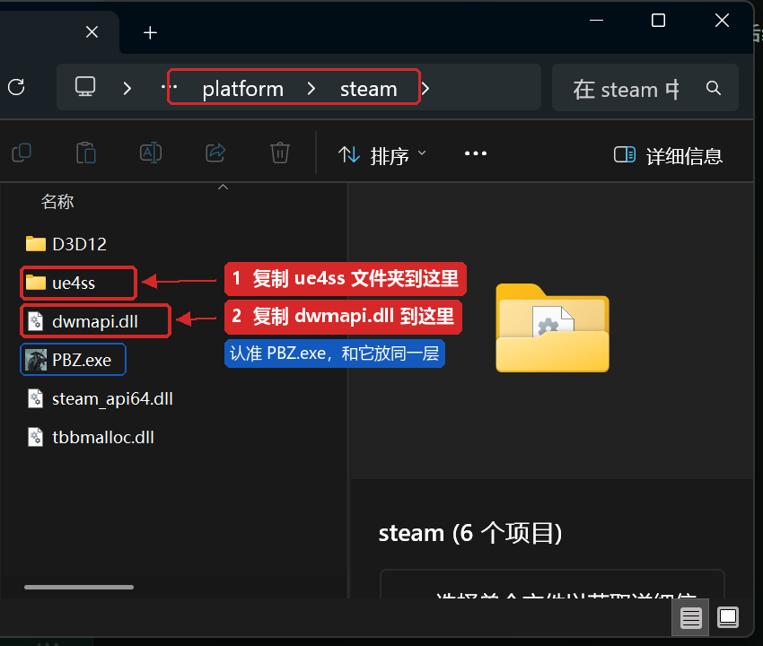
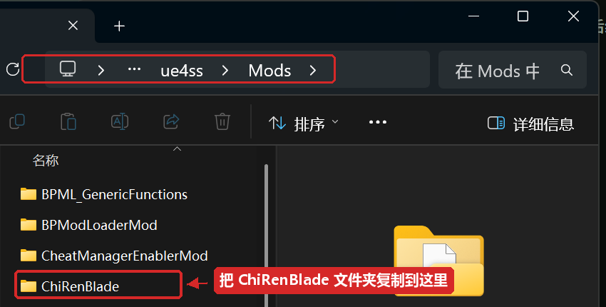
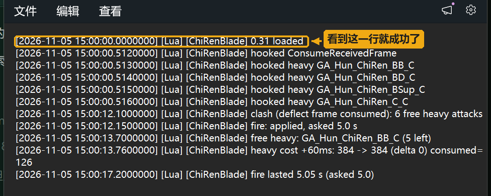
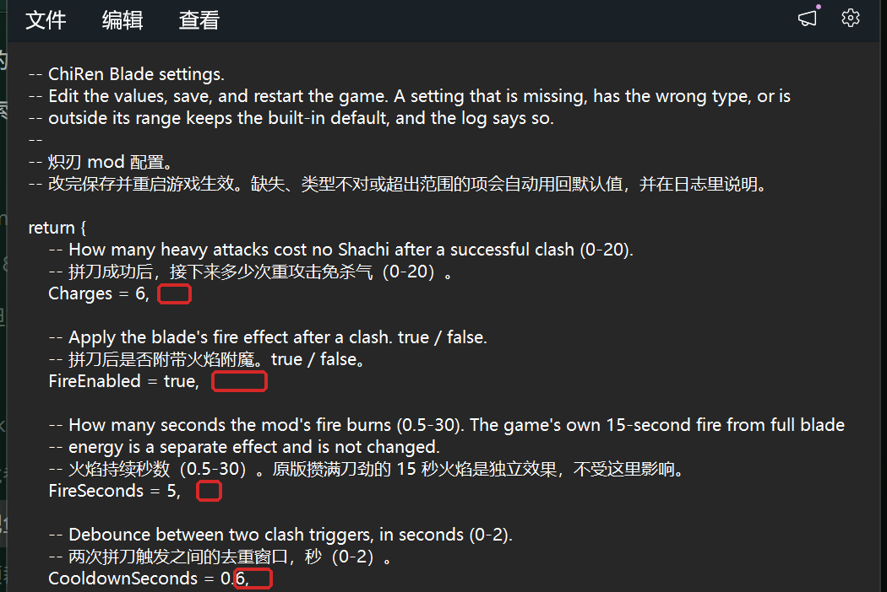
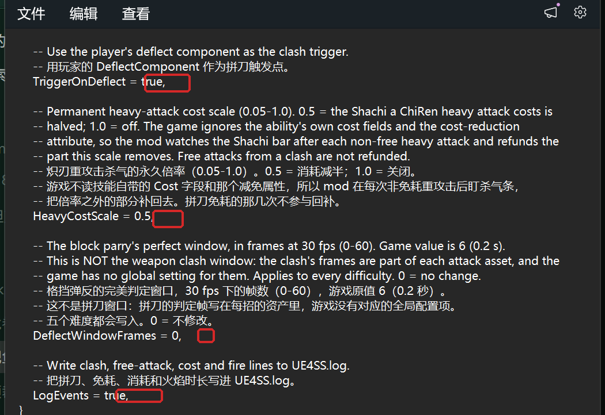

影之刃零 炽刃 mod 安装教程（小白版）

适用版本：ChiRen Blade 1.0
适用游戏：影之刃零（Steam 版）

本文档另有排好版的 Word 版本（安装教程-小白版.docx），随分享包一起提供，适合直接双击阅读。

一、这个 mod 能做什么

- 拼刀成功后，接下来 6 次重攻击（Y 键的 B 系连招）不消耗杀气。
- 拼刀成功后刀会着火 5 秒，并获得 1.2 秒无敌。游戏原本攒满刀劲的 15 秒火焰不受影响，两者可以同时存在。
- 拼刀会累积层数：风回云卷（刀劲三档时的 LB+Y）倍率就等于层数（1 层 1 倍……6 层 6 倍），最多存 6 层。
  双发龙卷的第二发沿用第一发倍率；每次释放还有 2.5 秒无敌，并施加或延长 15 秒火焰。
- 每 3 次拼刀会打断敌人一次，用的是游戏自己的 Break 受击，敌人会自己恢复。
- 炽刃的重攻击永久半价：杀气条会先正常扣除，大约一秒内自动补回一半。
- 切出炽刃那一下起手也能弹反（默认 10 帧约 0.33 秒），弹反成功同样拿到免耗、火焰和无敌；切武还会保留刀劲层数。
- 可选捷径：打开 TornadoEasyCast 后，1 次拼刀就能放风回云卷（默认关闭，见第七节）。
- 可选放缓：打开 ClashSlowmoEnabled 后，拼刀时在游戏自带放缓之上再叠一层更明显的慢动作（默认关闭）。
- 一个可选的格挡弹反窗口加长，默认关闭，新手不用管。

二、下载包里有什么

完整的包应该包含这三样：

1. dwmapi.dll              （mod 运行环境的一部分）
2. ue4ss 文件夹            （mod 运行环境）
3. ChiRenBlade 文件夹      （本 mod）

如果你的下载包里只有 ChiRenBlade 文件夹，说明缺少运行环境，请回到分享页下载完整包。
运行环境（UE4SS）是影之刃零专用的定制版本，不能用网上其他游戏的版本代替。

其中 UE4SS 运行环境由开源项目 UE4SS-RE/RE-UE4SS 开发，采用 MIT 许可。本分享包使用的是官方
v3.0.1-1195-g1ceefac8 构建，由 KintaroModding 原样打包并附带影之刃零的配置文件。

三、安装前准备

1. 完全退出游戏
   在 Steam 里点“停止”，确认任务栏和托盘里也没有游戏进程。

2. 建议备份存档（几分钟，防止意外）
   打开游戏目录，找到：
   ProjectPBZ\Saved\SaveGames\Steam\（一长串数字）\
   把里面的存档文件复制一份到桌面或别的文件夹。
   （直接复制整个 Saved 文件夹也可以，更省事。）

3. 找到游戏目录
   打开 Steam 库，右键《影之刃零》，选择“管理” → “浏览本地文件”。
   正确的目录里应该能看到 PBZ.exe 和 platform 文件夹。
   Steam 装在哪个盘都无所谓，以你电脑上的实际路径为准。

四、安装（分两步）

第 1 步：安装运行环境

把下载包里的 dwmapi.dll 和 ue4ss 文件夹，复制到：

游戏目录\platform\steam\

这个文件夹里本来就有 PBZ.exe，放进去后它们应该是并排的。
如果提示同名文件，选择“替换目标中的文件”。
如果提示合并文件夹，选择“合并”。

第 2 步：安装 mod

把下载包里的 ChiRenBlade 文件夹，复制到：

游戏目录\platform\steam\ue4ss\Mods\

放好之后，这个路径下应该有文件：
游戏目录\platform\steam\ue4ss\Mods\ChiRenBlade\Scripts\main.lua

注意是复制整个 ChiRenBlade 文件夹，不要把里面的 Scripts 文件夹单独拖出来。
Mods 里其他文件夹是 UE4SS 自带的，不用管。

五、第一次启动，确认 mod 生效

1. 启动游戏。
2. 用记事本打开：
   游戏目录\platform\steam\ue4ss\UE4SS.log
3. 按 Ctrl+F 搜索 ChiRenBlade。
   看到下面这一行就说明加载成功：
   [ChiRenBlade] 1.0 loaded

如果游戏第一次启动时卡在编译着色器，等几分钟，这是正常的，不是卡死。

六、怎么玩

- 拼刀：敌人出刀时你也出刀，两把刀碰在一起、有火花和响声，这就是拼刀。
  拼刀不是按住格挡，也不是弹反。
- 拼刀成功后会提示获得 6 次免耗重攻击。接下来按 Y 键打重攻击，杀气不会减少。
- 免耗次数按“技能放出来”计算，不是按命中计算。一套 B → BB → BBB 按三下，会消耗 3 次。
- 次数用完后恢复正常的杀气消耗（但仍然是半价）。
- 拼刀后刀会着火 5 秒，并且有 1.2 秒无敌。无敌期间基本不会掉血。
- 拼刀还会累积龙卷层数，日志里显示为“tornado combo: 4/6”（4 层，上限 6 层）。
  刀劲三档时按 LB+Y 放风回云卷，倍率就等于层数：1 层 1 倍、4 层 4 倍、6 层 6 倍。双发时第二发沿用第一发倍率。
- 每 3 次拼刀会把敌人打断一次，敌人会自己恢复，不是永久硬直。
- 切出炽刃那一下起手也能弹反，弹反成功和拼刀一样拿奖励；切武不会丢刀劲层数。
- 重攻击半价是“先扣后补”：杀气条会先掉下去，大约一秒内补回一半，属于正常现象。

七、修改设置（可选）

用记事本打开：

游戏目录\platform\steam\ue4ss\Mods\ChiRenBlade\Scripts\config.lua

文件里每一项都有中文说明，只改等号右边的值即可。

各个设置的作用：

Charges = 6
  拼刀后免杀气重攻击的次数。范围 0-20。
  改成 0 就是关闭免耗（火焰不受影响）。

FireEnabled = true
  拼刀后是否给刀上火。true = 开，false = 关。

FireSeconds = 5
  mod 这层火焰持续几秒。范围 0.5-30。
  游戏原本的 15 秒火焰不受这个数字影响。

CooldownSeconds = 0.6
  两次拼刀之间的去重时间，单位秒。范围 0-2。
  一般不用改。改得太大，短时间内的第二次拼刀可能不生效。

TriggerOnDeflect = true
  是否用玩家的弹刀动作作为拼刀触发。一般保持 true。
  改成 false 后免耗和火焰都不会触发，只用于排查问题。

HeavyCostScale = 0.5
  重攻击杀气的永久倍率。范围 0.05-1.0。
  0.5 = 半价，1.0 = 关闭。
  和饰品的杀气消耗降低可以叠加。

DeflectWindowFrames = 0
  格挡弹反的完美窗口帧数。范围 0-60。0 = 不修改。
  这是格挡弹反的窗口，不是拼刀窗口；改了对所有武器生效。
  新手保持 0 即可。

SwitchDeflectFrames = 10
  炽刃切武攻击的弹反窗口帧数（30fps）。范围 0-60，0 = 关闭。
  切出炽刃那一下起手能弹反的时长，10 帧约 0.33 秒。新手保持默认即可。

SwitchKeepStacks = true
  切武后是否保留刀劲层数。true = 保留。

InvulnSeconds = 1.2
  拼刀后的无敌秒数。范围 0-5。0 = 关闭。

HealthGuard = false
  无敌期间是否每 16 毫秒把血量写回起始值，作为游戏无敌之外的兜底。
  默认关闭；如果发现无敌期间仍然掉血，再改成 true。

TornadoClashMin = 1
TornadoClashMax = 6
  龙卷倍率的下限和上限。默认 1-6，即倍率=拼刀层数，最多存 6 层。
  范围分别是 1-6 和 3-10。想要保底倍率就把 Min 调高。

TornadoEasyCast = false
  拼刀后强制把刀劲顶到三档，让 1 次拼刀就能放风回云卷。默认关闭。
  打开后拼刀 1 次刀劲条即满，放龙卷前的普通重攻击可能吃到满档加成。

BreakOnClash = true
BreakThreshold = 3
  是否启用拼刀打断，以及蓄满打断需要的拼刀次数。范围 1-10。

LogDamage = false
  是否写伤害日志并采样敌人血量。默认关闭；排查伤害问题时再打开。

ClashSlowmoSeconds = 0.4
  拼刀成功时额外放缓的秒数。范围 0.05-2.0。
  原版拼刀本来就会短暂放缓，这一层是叠加增强，默认关闭（ClashSlowmoEnabled = false）。
  想要更明显的打击反馈再把它改成 true，玩家也跟着慢。

LogEvents = true
  是否把 mod 的运行信息写进 UE4SS.log。
  遇到问题需要排查时保持 true。

改设置的注意事项：

- 数字后面的逗号要保留，最后一项后面的逗号可以留也可以删。
- true 和 false 不要加引号，全部小写。
- 只改等号右边的值，不要改左边的名字。
- 保存文件后，必须完全退出游戏再重新启动才生效。
- 写错了不会坏存档：数值不对时 mod 会自动用回默认值；如果漏了逗号导致整个文件格式错误，
  所有设置都会回到默认值，日志里会有说明。

默认设置的完整样子：

return {
    Charges = 6,
    FireEnabled = true,
    FireSeconds = 5,
    CooldownSeconds = 0.6,
    TriggerOnDeflect = true,
    HeavyCostScale = 0.5,
    DeflectWindowFrames = 0,
    SwitchDeflectInject = true,
    SwitchDeflectFrames = 10,
    SwitchKeepStacks = true,
    InvulnSeconds = 1.2,
    HealthGuard = false,
    TornadoInvulnSeconds = 2.5,
    TornadoClashMin = 1,
    TornadoClashMax = 6,
    TornadoDamageScale = 1.0,
    TornadoDamageSeconds = 4.0,
    TornadoBurnSeconds = 15,
    TornadoEasyCast = false,
    BreakOnClash = true,
    BreakThreshold = 3,
    BreakHoldSeconds = 1.2,
    ClashSlowmoEnabled = false,
    ClashSlowmoSpeed = 0.3,
    ClashSlowmoSeconds = 0.4,
    LogEvents = true,
    LogDamage = false,
}

八、常见问题

1. 游戏启动不了，或者一启动就闪退
   - 确认 dwmapi.dll 和 ue4ss 文件夹放在 platform\steam\ 里，和 PBZ.exe 同一层。
   - 检查杀毒软件是否把 dwmapi.dll 删掉或隔离了。如果被隔离，从杀毒软件里恢复，并把游戏目录加入信任。
   - 如果之前装过别的 UE4SS，先删掉旧的 ue4ss 文件夹和 dwmapi.dll，再按本教程重装。

2. 日志里搜不到 ChiRenBlade
   - 确认游戏是从 Steam 正常启动的，不是从别的快捷方式。
   - 确认 ChiRenBlade 文件夹在 ue4ss\Mods\ 下面，而且里面能看到 Scripts\main.lua。
   - 确认装完后重启过游戏。
   - 确认 dwmapi.dll 没有被杀毒软件删掉。

3. 拼刀了，但没有免耗次数
   - 拼刀是双方同时出刀碰撞，不是按住格挡。格挡和弹反不会触发。
   - 检查 Charges 是不是被改成了 0。
   - 检查 TriggerOnDeflect 是不是被改成了 false。
   - 看日志里有没有 “clash (deflect frame consumed)” 这一行，有就说明触发成功了。

4. 杀气条先掉下去，过一会儿又回了一点
   这是正常的。游戏先按原价扣，mod 随后把减半的部分补回来。

5. 火焰时间和设置里写的不完全一样
   火焰在 5 秒左右结束，日志会记录实际时长。如果刀本来就在燃烧（原版 15 秒火），
   两层火会各自计时，互不影响。

6. 龙卷伤害没有变化，或者倍率不对
   - 风回云卷需要刀劲三档才能放；刀劲没满时按 LB+Y 出的是普通招式。
   - 看日志里的 “tornado combo: n/6”，倍率就等于层数（1 层 1 倍……6 层 6 倍）；释放后层数清零。
   - 耗杀气的龙卷变体（C）保持原版伤害，只有刀劲三档的 BSup 龙卷吃倍率。
   - 想 1 次拼刀就放龙卷，把 TornadoEasyCast 改成 true（默认关闭）。

7. 打 boss 连战时血条完全不动，但杀气条能打崩
   先检查 BossRushTrainer（复战训练器）里这个 boss 的“Boss 免伤”是不是开着。
   这个选项会保留命中和受击，但锁住 boss 血量，龙卷也会没伤害。
   在训练器设置里关掉“Boss 免伤”再试。

8. 无敌期间仍然掉血
   把 config.lua 里的 HealthGuard 改成 true，再重启游戏。
   这会开启 16 毫秒一次的血量写回兜底。

9. 拼刀时的慢动作不明显 / 想更明显
   原版拼刀本来就有短暂放缓。mod 这层额外放缓默认关闭（ClashSlowmoEnabled = false）。
   想要更明显的慢动作，把它改成 true，再用 ClashSlowmoSpeed / ClashSlowmoSeconds 调强度和时长。

10. 改了 config.lua 但没有变化
   必须完全退出游戏再启动。只退回主菜单不算重启。

11. 游戏更新后 mod 失效
   游戏大版本更新可能改变内部结构，需要等待适配后的新版 mod 和 UE4SS。
   更新游戏前可以先备份存档。

九、卸载

- 只卸载 mod：删除游戏目录\platform\steam\ue4ss\Mods\ChiRenBlade 文件夹。
- 连运行环境一起卸载：再删除平台目录里的 dwmapi.dll 和 ue4ss 文件夹。
  注意：这样其他依赖 UE4SS 的 mod 也会一起失效。
- 删除前建议先退出游戏。

十、注意事项

- 请只从本分享页下载。网上来路不明的 dwmapi.dll 可能是病毒，不要随便替换。
- mod 只修改单机游戏数据，不会影响其他玩家。
- 安装和卸载前先退出游戏，不要在游戏运行时改文件。
- 如果游戏出现异常，先删除 mod 文件夹并重启，确认是不是 mod 引起的。
